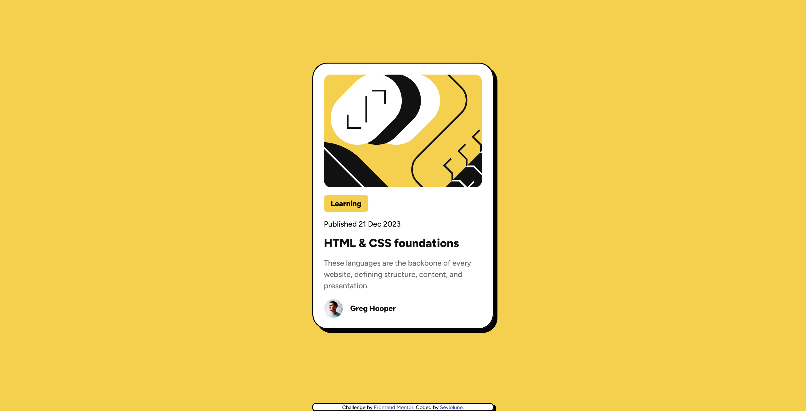

# Frontend Mentor - Blog preview card solution

This is a solution to the [Blog preview card challenge on Frontend Mentor](https://www.frontendmentor.io/challenges/blog-preview-card-ckPaj01IcS).

## Overview

### The challenge

Users should be able to:

- See hover and focus states for all interactive elements on the page

### Screenshot

### Links

- Github repository URL: [https://github.com/Seviolune/blog-preview-card-main](https://github.com/Seviolune/blog-preview-card-main)
- Solution URL: [https://www.frontendmentor.io/challenges/blog-preview-card-ckPaj01IcS](https://www.frontendmentor.io/challenges/blog-preview-card-ckPaj01IcS)
- Live Site URL: [https://seviolune.github.io/blog-preview-card-main](https://seviolune.github.io/blog-preview-card-main)

## Author

- Github: [Seviolune](https://github.com/Seviolune)
- Frontend Mentor: [@Seviolune](https://www.frontendmentor.io/profile/seviolune)